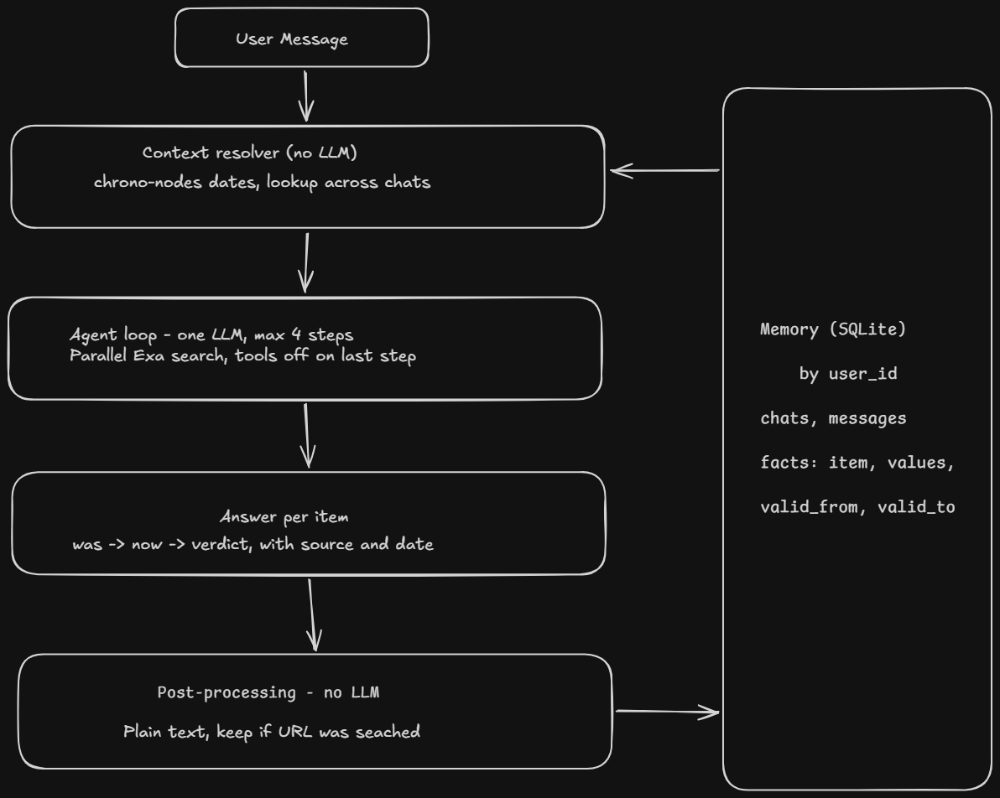

# Design 

**What it is.** A chat agent with one tool, web search, and memory across chats. It answers time-anchored questions such as "What did I ask you on 3 November? Is that still correct?" by loading what it said then and re-checking it on the web.

## How a request flow

1. **Resolver (code, no LLM).** chrono-node turns a phrase like "last Tuesday" into a date range. Code loads that user's saved questions, answers and facts from SQLite for those dates and adds them to the prompt. If nothing is saved, the prompt says so "no saved chat" and doesn't invent one.

2. **Agent loop (one LLM, max 4 steps).** The model decides what to search, and the Exa searches run in parallel. On the last step, tools are switched off, so the loop always ends with a written answer.

3. **Post-processing (Code, no LLM).** The answer ends with a hidden block of facts(item, value, source URL). A fact is saved only if its URL appeared in this turn's search results. A changed value retires the old fact and adds the new one. The reply is converted to plain text and saved.

## Why this design

The model is used for judgement: what to search for and how to campare. Code does everything that has one right answer: date, lookups, saving and validation.

- **Fast.** The data is resolved in code, so there is no extra call before the search starts.
- **Predictable.** A model can misread "last Tuesday". chrono-node cannot.
- **Safe memory.** The model proposes facts and code decides what is saved, using theURL check above.

## Memory

Memory lives in SQLite(Node's built-in `node:sqlite`), keyed by user id, so a new chat can see earlier chats.

- `chats` and `messages`: what was asked and answered.
-`facts`: what was true, with `item`, `value`, `source_url`, `observed_at`, `valid_from`, `valid_to`.

when a re-check finds a different value, the old fact is retired (`valid_to` is set) and the new one is added. Nothing is overwritten, so the agentcan answer both "what was it then" and "what is it now".

## What I rejected

- **A router with memory and search sub-agents.** It adds model calls, latency and places(**) to lose context, for an agent with one toll.
- **A memory agent.** Resolving "last Tuesday" and loading that day's chats has one right answer, so code does it, not a model.
- **LLM_managed memory (MemGPT style).** Amodel that decides what to remember and fetch is flesxible but unpredictable. Mine proposes facts and code decides.
- **A vector database.** The questions are anchored on dates andnames, where exact lookup beats similarity.
- **LangChain or LanGraph.** The control file is one loop, and a framework would hide the part I need to explain.
- **React.** It adds a build step to a plain chat page, and could break `npm install` then `npm run dev`. 

## Known limits 

- **Undated questions get no memory lookup.** "Anything about Postgres costs?" loads no earlier chats. "Last week" resolves to a single day.
- **Only facts are URL-checked.** URLs written inside the answer text are not verified against the search results.
- **No streaming** Answer take about 3 to 8 seconds.
- **The free Gemini tier can overload.** Retries are short and there is no fallback model.
- **No login** A random id in the browser identifies the user. Clearing the site data starts a new user, and the id is not authenticated.

## With another week

1. Streaming with status lines such as "Searching...", Plus a URL check on answer text.
2. A keyword fallback, so undated questions still find earlier chats.
3. Login and a better UI.
4. More input types. Gemini accepts image and PDFs, so a file could be sent as an extrapart of the message.
